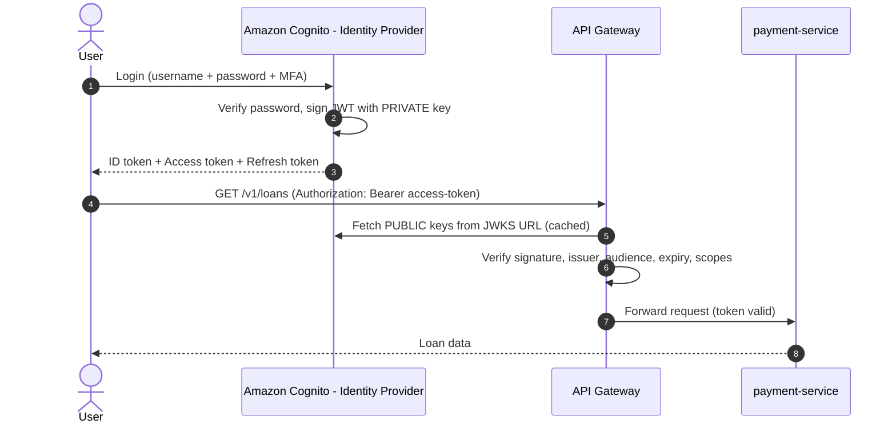
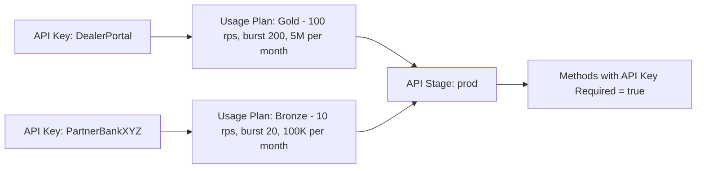
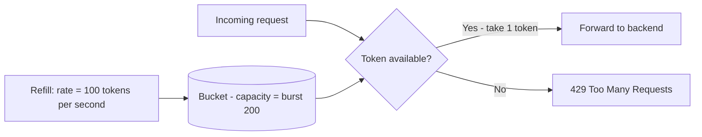
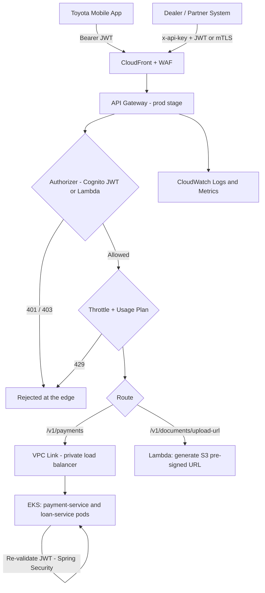

# AWS API Gateway — Deep Dive for Backend Engineers

> Companion to [AWS_FOR_BACKEND_ENGINEERS.md](./AWS_FOR_BACKEND_ENGINEERS.md) section 5.4.

## Scope Tags
| Tag | Meaning |
|---|---|
| ✅ **Core BE** | Understand deeply; you'll debug and design around it |
| 🟡 **Good to know** | Know what it is and how it's configured; DevOps usually builds it |
| ❌ **Beyond scope** | One-line awareness is enough |

---

## 1. What Is AWS API Gateway? — ✅

AWS API Gateway is a **fully managed "front door"** for your backend APIs. Every request from the Toyota mobile app hits API Gateway first. It decides:

1. **Is this caller allowed in?** (WAF, API key, JWT authorizer)
2. **Is this caller sending too much?** (throttling / quotas)
3. **Is the request well-formed?** (request validation)
4. **Where should it go?** (routing to EKS, Lambda, or another AWS service)
5. **What happened?** (logging, metrics, tracing)

Your Spring Boot service only receives requests that **survived all of these checks**.

### It replaces (or sits in front of) our local Spring Cloud Gateway

| Concern | Our local project | AWS production |
|---|---|---|
| Routing `/payments/**` → payment-service | Spring Cloud Gateway routes | API Gateway routes + integrations |
| Rate limiting | Redis `RequestRateLimiter` | API Gateway throttling + usage plans |
| JWT validation | (not built yet) | JWT / Cognito / Lambda authorizer |
| Firewall | none | AWS WAF attached to API Gateway |

Some companies use **only** AWS API Gateway. Others keep an internal gateway (Spring Cloud Gateway) inside EKS for service-to-service concerns. Both patterns are common.

---

## 2. The Three Flavors of API Gateway — 🟡

| | **REST API** (v1) | **HTTP API** (v2) | **WebSocket API** |
|---|---|---|---|
| Purpose | Full-featured enterprise APIs | Cheaper, faster, simpler APIs | Real-time two-way (chat, live updates) |
| Cost / latency | Higher | ~70% cheaper, lower latency | Per message/connection |
| **API keys + usage plans** | ✅ Yes | ❌ No | ❌ No |
| **Native JWT authorizer** | ❌ (use Cognito or Lambda authorizer) | ✅ Yes | ❌ |
| Cognito authorizer | ✅ | ✅ (via JWT authorizer) | — |
| Lambda authorizer | ✅ | ✅ | ✅ |
| Request validation (JSON schema) | ✅ | ❌ | — |
| Response caching | ✅ | ❌ | — |
| **AWS WAF attachment** | ✅ | ❌ (must put CloudFront/ALB in front) | — |

> **Enterprise reality (TFS-like):** Partner/B2B APIs that need API keys, WAF, and usage plans usually use **REST API**. Simple internal or mobile-backend APIs often use **HTTP API**.

---

## 3. Core Building Blocks — ✅ / 🟡

| Term | What it is | Example |
|---|---|---|
| **Resource / Route** | A URL path | `/v1/payments`, `/v1/loans/{loanId}` |
| **Method** | HTTP verb on a resource | `POST /v1/payments` |
| **Integration** | Where the request is forwarded | EKS service, Lambda, SQS, DynamoDB |
| **Stage** | A deployed version/environment | `dev`, `qa`, `prod` → `https://api.../prod/v1/payments` |
| **Deployment** | A snapshot of the config pushed to a stage | "Deploy to prod" |
| **Stage variables** | Per-stage config values | `backendUrl = payment-dev.internal` vs `payment-prod.internal` |
| **Authorizer** | Code/config that decides who's allowed in | JWT, Cognito, Lambda authorizer |
| **Usage plan** | Throttle + quota rules attached to API keys | "Gold partners: 100 req/s, 1M/month" |
| **VPC Link** | Private tunnel from API Gateway into your VPC | Reach EKS behind a private load balancer |
| **Custom domain** | Friendly hostname | `api.toyotafinancial.com` instead of `abc123.execute-api.us-east-1.amazonaws.com` |

---

## 4. The Full Request Lifecycle — ✅ (most important section)

```mermaid
sequenceDiagram
    autonumber
    actor App as Toyota Mobile App
    participant WAF as AWS WAF
    participant GW as API Gateway
    participant Auth as Authorizer - JWT or Lambda
    participant Link as VPC Link + Private Load Balancer
    participant Pod as payment-service Pod on EKS

    App->>WAF: POST /v1/payments + Authorization: Bearer JWT + x-api-key
    WAF->>WAF: SQLi / XSS / bad IP / geo rules
    alt Malicious
        WAF-->>App: 403 Forbidden
    end
    WAF->>GW: Clean request
    GW->>GW: Route match? (POST /v1/payments)
    GW->>GW: API key valid? (REST API only)
    alt Missing or invalid key
        GW-->>App: 403 Forbidden
    end
    GW->>Auth: Validate JWT
    alt Token missing / expired / bad signature
        Auth-->>App: 401 Unauthorized
    end
    Auth-->>GW: Allowed + user claims
    GW->>GW: Throttling + quota check (token bucket)
    alt Over the limit
        GW-->>App: 429 Too Many Requests
    end
    GW->>GW: Request validation (JSON schema)
    alt Invalid body
        GW-->>App: 400 Bad Request
    end
    GW->>Link: Forward request (+ claims as headers)
    Link->>Pod: HTTP to Spring Boot controller
    Pod-->>GW: 201 Created
    GW-->>App: 201 Created
    Note over GW: If the pod takes longer than the integration timeout, API Gateway returns 504
```

**The order matters for triage:** if a request fails with `429`, you know it already passed WAF, API key, and JWT checks.

---

## 5. JWT Token Setup — How Authentication Works at the Gateway

### 5.1 The Big Picture — ✅



Key points:
*   **Cognito (or Okta/Auth0/Ping) creates tokens.** API Gateway and your services only **verify** them.
*   Verification uses Cognito's **public keys** published at its **JWKS URL**:
    `https://cognito-idp.us-east-1.amazonaws.com/<userPoolId>/.well-known/jwks.json`
*   The gateway checks: **signature**, **issuer (`iss`)**, **audience (`aud`/`client_id`)**, **expiry (`exp`)**, and optionally **scopes**.

### 5.2 The Three Types of Authorizers

#### Option A: JWT Authorizer (HTTP API) — 🟡 setup / ✅ concept
Pure configuration, no code. You give API Gateway two things:

| Setting | Value |
|---|---|
| **Issuer URL** | `https://cognito-idp.us-east-1.amazonaws.com/us-east-1_AbCdEf` |
| **Audience** | The app client ID(s) allowed to call this API |
| **Identity source** | `$request.header.Authorization` |
| **Authorization scopes** (per route, optional) | e.g. `payments/write` required for `POST /v1/payments` |

Works with **any OIDC-compliant** identity provider (Cognito, Okta, Auth0, Azure AD).

#### Option B: Cognito User Pool Authorizer (REST API) — 🟡
Same idea for REST APIs: point the authorizer at your Cognito User Pool, set the token header, and optionally require OAuth scopes on each method.

#### Option C: Lambda Authorizer (custom) — ✅ (BE engineers sometimes write these)
A small Lambda function **you write** that runs before your backend. Use it when you need custom logic:
*   Tokens from a non-OIDC / legacy identity system
*   Extra checks: "Is this customer's account suspended?" or "Does this dealer ID own this loan?"
*   Validating custom headers or HMAC signatures from partners

**How it works:**
1. API Gateway calls your Lambda with the token (TOKEN type) or headers/query params (REQUEST type).
2. Your Lambda verifies it and returns an **IAM policy** (`Allow`/`Deny`) plus a **context** map (e.g. `userId`, `role`).
3. API Gateway **caches** the result (default **300 seconds**, keyed by the token) so the Lambda isn't called on every request.

```java
// Simplified Lambda authorizer (REST API, TOKEN type)
public class TokenAuthorizer implements RequestHandler<Map<String, Object>, Map<String, Object>> {
    @Override
    public Map<String, Object> handleRequest(Map<String, Object> event, Context ctx) {
        String token = ((String) event.get("authorizationToken")).replace("Bearer ", "");
        String methodArn = (String) event.get("methodArn");

        DecodedJwt jwt = jwtVerifier.verify(token);   // signature, iss, aud, exp
        String effect = jwt.isValid() ? "Allow" : "Deny";

        return Map.of(
            "principalId", jwt.getSubject(),
            "policyDocument", Map.of(
                "Version", "2012-10-17",
                "Statement", List.of(Map.of(
                    "Action", "execute-api:Invoke",
                    "Effect", effect,
                    "Resource", methodArn))),
            "context", Map.of("userId", jwt.getSubject(), "role", jwt.getClaim("role"))
        );
    }
}
```

> ⚠️ **Caching gotcha:** If the cached policy was generated for one specific `methodArn`, the same token calling a *different* endpoint can get a wrong `403` from the cache. Use wildcards in the resource ARN or disable caching for per-route decisions.

### 5.3 What Reaches Your Spring Boot Service — ✅

After the gateway validates the token, you have two common patterns:

**Pattern 1 — Trust the gateway, read forwarded claims.**
API Gateway maps claims into headers (e.g., `X-User-Id`, `X-User-Roles`) via parameter mapping. Your controller reads them:
```java
@GetMapping("/v1/loans")
public List<LoanResponse> myLoans(@RequestHeader("X-User-Id") String userId) {
    return loanService.findByCustomer(userId);
}
```
Only safe if the service is **unreachable except through the gateway** (private subnets, VPC Link, security groups).

**Pattern 2 — Validate again in Spring Boot (defense in depth / "zero trust").** ✅ Common in banking/finance.
The gateway forwards the original `Authorization` header. Spring Security re-verifies it using the same JWKS:
```yaml
# application.yml
spring:
  security:
    oauth2:
      resourceserver:
        jwt:
          issuer-uri: https://cognito-idp.us-east-1.amazonaws.com/us-east-1_AbCdEf
```
```java
@PreAuthorize("hasAuthority('SCOPE_payments/write')")
@PostMapping("/v1/payments")
public ResponseEntity<PaymentResponse> create(@AuthenticationPrincipal Jwt jwt,
                                              @Valid @RequestBody PaymentRequest req) {
    String customerId = jwt.getSubject();   // never trust a customerId from the request body
    ...
}
```

> 🔑 **Security rule for BE engineers:** Always derive *who the user is* from the **token**, never from a field the client sends in the body/URL. Otherwise user A can pay with or view user B's loan (an **IDOR** vulnerability — Insecure Direct Object Reference).

---

## 6. API Keys & Usage Plans — 🟡 setup / ✅ concept

### 6.1 What an API key is (and is NOT)
*   A long random string the client sends in the **`x-api-key`** header.
*   **Purpose:** *identify* and *meter* a client application (e.g., "Dealer Portal", "Partner Bank XYZ") so you can apply per-client throttles and quotas and track usage.
*   **NOT authentication.** AWS explicitly says don't rely on API keys alone for authorization — they're easy to leak (hardcoded in mobile apps, logged in proxies). Always combine them with **JWT / IAM / Lambda authorizer**.

| | API Key | JWT |
|---|---|---|
| Identifies | A **client application** | A **user** (and their roles/scopes) |
| Expires | Not automatically (until rotated) | Yes, short-lived (e.g. 1 hour) |
| Cryptographically verifiable | No (just a lookup) | Yes (signature) |
| Main use | Metering, per-partner throttling | Authentication + authorization |

### 6.2 How it's set up (REST API only)



1. **Create a Usage Plan** with:
   *   **Throttle:** steady **rate** (requests/second) + **burst** (short spike capacity)
   *   **Quota:** max requests per **day / week / month**
2. **Associate the plan with an API stage** (e.g., `prod`), optionally with per-method throttle overrides.
3. **Create API keys** (one per client) and **attach them** to the usage plan.
4. On each method, set **"API Key Required" = true**.
5. Securely deliver the key to the partner (and rotate it periodically).

**Responses:** missing/invalid key → **`403 Forbidden`**. Over throttle → **`429 Too Many Requests`**. Over monthly quota → **`429`** with a "Limit Exceeded" message.

---

## 7. Rate Limiting / Throttling — ✅

### 7.1 The Algorithm: Token Bucket
API Gateway uses the same **token bucket** algorithm as our Redis rate limiter:
*   The bucket holds up to **burst** tokens.
*   It refills at **rate** tokens per second.
*   Each request takes one token. Empty bucket → **`429 Too Many Requests`**.



### 7.2 The Four Levels of Throttling (applied together; the strictest wins)

| Level | Who sets it | Example |
|---|---|---|
| **1. AWS account / region limit** | AWS (default **10,000 rps steady, 5,000 burst** per region, shared by all APIs in the account; can request an increase) | Protects AWS itself |
| **2. Stage level** | DevOps | `prod` stage: 2,000 rps |
| **3. Method / route level** | DevOps (with BE input) | `POST /v1/payments`: 200 rps (expensive), `GET /v1/loans`: 1,000 rps |
| **4. Per-client (usage plan + API key)** | DevOps / API product owner | Partner XYZ: 10 rps, 100K/month |

> ⚠️ **AWS throttling is "best effort,"** not an exact guarantee. A few extra requests may slip through briefly. Never use it as a billing-accurate counter or a security control.

### 7.3 AWS Throttling vs Our Redis Rate Limiter

| | API Gateway throttling | Redis-based limiter (our Spring Cloud Gateway) |
|---|---|---|
| Granularity | Global, per stage, per method, **per API key** | **Anything you choose** — per user ID from JWT, per IP, per account |
| **Per end-user limits** | ❌ Not natively (only per API key) | ✅ Yes |
| Effort | Configuration only | Code + Redis cluster to run |
| Use case | Protect the platform, enforce partner plans | Business rules like "max 5 payment attempts per user per minute" |

**In practice, both are used together:** API Gateway protects the platform, and app-level (Redis) limits enforce per-user business rules.

### 7.4 What the client should do on 429 — ✅
Retry with **exponential backoff + jitter** (wait 1s, 2s, 4s… plus randomness), and respect a `Retry-After` header if present. And because retries happen, **payment endpoints must be idempotent** (our Idempotency-Key work).

---

## 8. Other Features You'll Encounter

| Feature | What it does | Tag |
|---|---|---|
| **Integrations: Lambda proxy** | Passes the whole HTTP request to a Lambda as JSON | ✅ |
| **Integrations: HTTP proxy + VPC Link** | Forwards to a **private** load balancer in front of EKS — the typical TFS pattern for Spring Boot | ✅ concept |
| **Integrations: AWS service** | Writes straight into SQS/DynamoDB/Step Functions with no compute in between | 🟡 |
| **Request validation** (REST) | Rejects bad JSON against a JSON Schema model before it reaches you (`400`). Doesn't replace your `@Valid`! | 🟡 |
| **Mapping templates (VTL)** (REST) | Reshapes requests/responses | ❌ |
| **Response caching** (REST) | Caches GET responses per stage for a TTL | 🟡 |
| **CORS** | Lets browser apps on other domains call the API | ✅ (you'll debug CORS errors) |
| **Mutual TLS (mTLS)** | Client must present a certificate — common for B2B/bank partners | 🟡 |
| **Resource policies** | Restrict which IPs/VPCs/AWS accounts can call the API (private APIs) | 🟡 |
| **Custom domains + certificates (ACM)** | `api.toyotafinancial.com` | ❌ |
| **Access logs + execution logs (CloudWatch)** | Every request: status, latency, authorizer result, integration latency | ✅ |
| **X-Ray tracing** | End-to-end trace through gateway → service | 🟡 |

### Timeouts — ✅
*   **REST API integration timeout: 29 seconds by default** (Regional/private APIs can request a higher limit, at the cost of throttling quota).
*   **HTTP API: max 30 seconds.**
*   If your Spring Boot endpoint is slower than this, the client gets **`504`** even though your service may still finish the work. → Long work belongs in **async** flows (Kafka/SQS + polling or webhooks).

---

## 9. Triage Cheat Sheet — ✅

| Status | Who generated it | Likely cause | Where to look |
|---|---|---|---|
| **`400`** | Gateway request validator **or** your `@Valid` | Body fails JSON schema / bean validation | Gateway access log (did it reach the backend?) |
| **`401 Unauthorized`** | Authorizer | Missing token, expired token, wrong issuer/audience, bad signature | Decode the token at jwt.io-style tools (never paste prod tokens into public sites!) — check `exp`, `iss`, `aud` |
| **`403 Forbidden`** | WAF, API key check, authorizer `Deny`, resource policy, or **wrong path/method** | Missing `x-api-key`, missing scope, WAF block, calling a route that doesn't exist (REST APIs often return 403 "Missing Authentication Token" for unknown paths) | Response body message + WAF logs + authorizer logs |
| **`429 Too Many Requests`** | Throttling or quota | Burst exceeded, usage plan limit, account-level limit | CloudWatch `Count` metric, usage plan usage |
| **`500`** | Gateway (internal) or misconfigured integration/authorizer | Authorizer Lambda crashed, mapping template error | Execution logs |
| **`502 Bad Gateway`** | Gateway | Backend/Lambda returned a malformed response, crashed, or connection reset | Lambda logs / pod logs, response format |
| **`503 Service Unavailable`** | Gateway or load balancer | No healthy targets behind the VPC Link | Pod readiness probes, target group health |
| **`504 Gateway Timeout`** | Gateway | Backend slower than 29–30s, or network unreachable | APM traces, slow DB queries, security groups |

**Key metrics to watch (CloudWatch):** `Count`, `4XXError`, `5XXError`, `Latency` (total), `IntegrationLatency` (just your backend). If `Latency` ≫ `IntegrationLatency`, the time is being spent in the gateway/authorizer, not your code.

---

## 10. How It All Fits Together at TFS



## 11. Interview One-Liners — ✅
*   *"API Gateway is the managed front door: it authenticates (JWT/Cognito/Lambda authorizer), throttles (token bucket, usage plans), validates, routes, and logs before traffic ever hits our services."*
*   *"API keys identify and meter client applications; JWTs authenticate users. API keys are not a security mechanism by themselves."*
*   *"Gateway throttling protects the platform per stage, method, or API key; per-user business limits still need application-level rate limiting like Redis."*
*   *"We still validate the JWT in Spring Security and derive the customer ID from the token, never from the request body — defense in depth against IDOR."*
*   *"Because of the 29-second integration timeout, long-running work is pushed to async processing via Kafka/SQS."*
